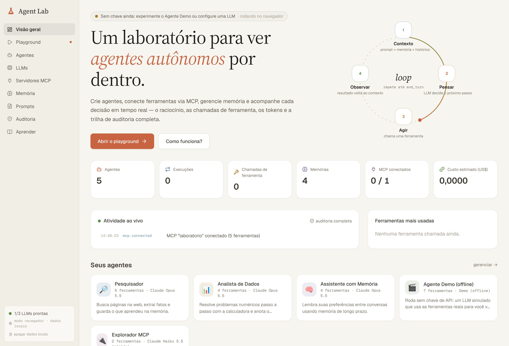
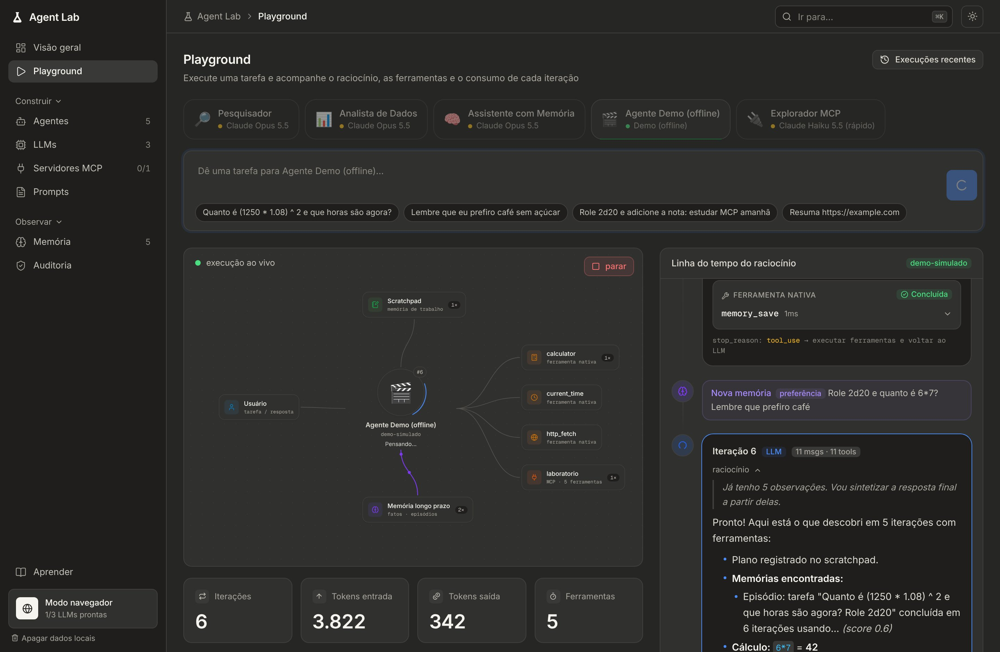
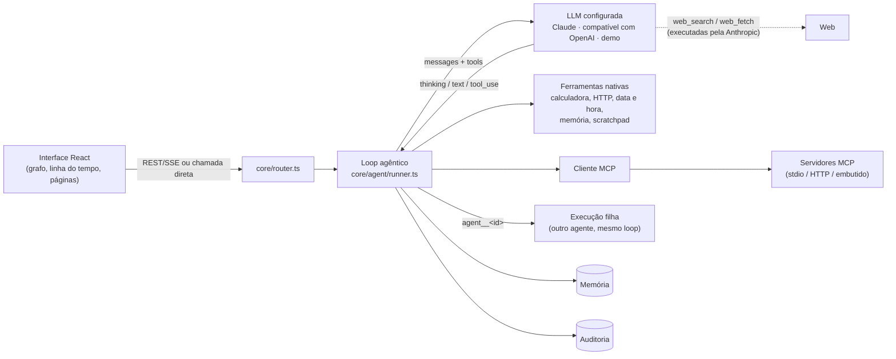

# Agent Lab

Plataforma visual para estudo de agentes autônomos. Permite configurar agentes com diferentes modelos de linguagem,
conectar ferramentas via **MCP**, gerenciar **prompts** e **memória** e acompanhar cada decisão do agente em tempo real,
com trilha de **auditoria** completa.

São suportados três tipos de provedor: Claude (SDK oficial da Anthropic), qualquer API compatível com o formato
OpenAI Chat Completions (OpenAI, OpenRouter, Groq, Ollama) e um modelo simulado para uso sem chave de API.


## Funcionalidades

| Tela | Descrição |
|---|---|
| **Playground** | Execução de tarefas com visualização do loop agêntico em tempo real: grafo de interação (modelo, ferramentas e memória), linha do tempo com raciocínio, chamadas `tool_use`/`tool_result` e consumo de tokens por iteração. Inclui inspeção da janela de contexto, continuação da conversa e aprovação manual de ferramentas (*human-in-the-loop*). |
| **Janela de contexto** | Medidor por iteração (tokens de entrada, percentual da janela do modelo, cache e composição do contexto) e resumo automático do histórico ao passar de um limite configurável por agente, registrado na linha do tempo e na auditoria. |
| **Multiagente** | Agentes podem delegar subtarefas a outros agentes, usados como ferramentas. Cada delegação é uma execução filha acompanhada ao vivo dentro da execução pai, com tokens agregados, limite de profundidade e bloqueio de delegação circular. |
| **Comparar** | Execução da mesma tarefa em paralelo em até quatro combinações de agente e LLM, com progresso ao vivo e tabela de tokens, custo, duração, iterações e ferramentas, exportável em JSON. |
| **Agentes** | Configuração de agentes: LLM, prompt de sistema, ferramentas nativas, MCP e de servidor da Anthropic (busca e leitura de páginas web), política de memória, limite de iterações e aprovação humana. |
| **LLMs** | Cadastro de modelos em tempo de execução (provedor, modelo, chave, URL base e nível de esforço). Cada agente referencia uma LLM, que pode ser trocada a qualquer momento. |
| **Servidores MCP** | Conexão de servidores via `stdio`, HTTP ou execução embutida, edição da configuração, listagem das ferramentas descobertas, teste manual de `tools/call`, logs e diagnóstico de erros de conexão. |
| **Memória** | Quatro camadas (curto prazo, trabalho, longo prazo e episódica), visualização das memórias e simulação de recuperação com pontuação detalhada. |
| **Prompts** | Biblioteca de prompts de sistema e de tarefa, com suporte a variáveis `{{nome}}`. |
| **Auditoria** | Registro de todas as ações (autor, horário, tokens e duração), com filtros, atualização em tempo real e exportação em JSON. |
| **Aprender** | Material de apoio sobre o loop agêntico, o protocolo de ferramentas e os principais conceitos, com exercícios práticos. |

<p>
  
  
  
  
</p>

<p></p>

## Versão online

A interface é publicada no GitHub Pages pelo workflow [`deploy-pages.yml`](.github/workflows/deploy-pages.yml):
**https://leonardoletr.github.io/poc_agents_plataform/**

Nessa versão a aplicação opera em **modo navegador**: o núcleo é executado na própria página, os dados ficam no
armazenamento local do navegador e as chaves de API são informadas por cada usuário na tela **LLMs**.

Limitações do modo navegador:
- servidores MCP via `stdio` não estão disponíveis (HTTP e servidores embutidos funcionam normalmente);
- servidores MCP remotos precisam permitir requisições vindas da página (CORS); quando não permitem, a conexão falha
  com "Failed to fetch" e funciona pelo modo servidor;
- a ferramenta `http_fetch` só acessa sites que permitem requisições de outras origens (CORS). Com LLMs Anthropic, use
  `web_search` e `web_fetch`, executadas na infraestrutura da Anthropic e sem essa restrição.

## Execução local

Requisito: **Node.js 20+**.

```bash
npm install
cp .env.example .env      # opcional: ANTHROPIC_API_KEY / OPENAI_API_KEY
npm run dev               # API em :8787 e interface em http://localhost:5173
```

- O agente **Demo (offline)** funciona sem chave de API. O modelo é simulado, mas ferramentas, memória, MCP e auditoria
  operam normalmente.
- Para usar um modelo real, informe a chave na tela **LLMs** ou defina `ANTHROPIC_API_KEY` / `OPENAI_API_KEY` no `.env`.
  As variáveis de ambiente são usadas quando a LLM não possui chave própria.
- O servidor MCP de exemplo (`laboratorio`) é embutido e conecta automaticamente.
- O agente **Coordenador (offline)** demonstra o multiagente sem chave: delega a tarefa ao Agente Demo.
- O agente **Supervisor** usa Claude: divide a tarefa e delega ao Pesquisador (busca na web) e ao Analista de Dados
  (cálculos), consolidando as respostas. Requer a chave da LLM "Claude Opus 5.5".
- O **Agente Demo** usa uma janela simulada de 4 mil tokens: ao continuar a conversa algumas vezes, o resumo automático
  do histórico aparece no medidor e na linha do tempo.
- Se o servidor local não estiver disponível, a interface passa automaticamente para o modo navegador.

Build de produção: `npm run build && npm start` (a API passa a servir a interface em `http://localhost:8787`).

## Arquitetura

Toda a lógica está em [`core/`](core/), um núcleo **sem dependências de Node.js**, executado em dois modos:

| | Modo servidor (`npm run dev`) | Modo navegador (GitHub Pages) |
|---|---|---|
| Execução do núcleo | processo Node.js | página do navegador |
| Comunicação com a interface | HTTP + SSE | chamada de função |
| Persistência | `server/data/db.json` | `localStorage` |
| Transportes MCP | stdio, HTTP e embutido | HTTP e embutido |



O loop agêntico ([`core/agent/runner.ts`](core/agent/runner.ts)) executa, a cada iteração:

1. montagem do **contexto**: prompt de sistema, memórias recuperadas e histórico de mensagens;
2. chamada à **LLM do agente** com a lista de ferramentas. No Claude, com streaming, pensamento adaptativo com resumo e
   cache de prefixo; em provedores compatíveis com OpenAI, o histórico é convertido (`tool_use` ↔ `tool_calls`);
3. **execução das ferramentas** solicitadas (em paralelo, com aprovação opcional) e retorno de todos os `tool_result`
   em uma única mensagem;
4. medição da janela de contexto e, se o agente habilitou e o limite foi atingido, substituição do histórico por um
   resumo gerado pelo próprio modelo antes da próxima chamada;
5. repetição até `stop_reason: end_turn` ou até o limite de iterações. Ao final, um resumo pode ser salvo como memória
   episódica.

Cada etapa gera um evento para a visualização e um registro de auditoria.

### Estrutura

```
core/                  núcleo compartilhado (servidor e navegador)
  agent/runner.ts      loop agêntico
  agent/delegation.ts  multiagente: agentes como ferramentas
  agent/context.ts     medição da janela de contexto e resumo do histórico
  llm/                 provedores: anthropic.ts, openai.ts, demo.ts
  mcp/manager.ts       cliente MCP (stdio, Streamable HTTP, SSE e em memória)
  mcp/lab-server.ts    servidor MCP de exemplo
  tools/builtin.ts     ferramentas nativas
  tools/server.ts      ferramentas de servidor da Anthropic (web_search, web_fetch)
  memory.ts            memória de longo prazo e ranking de recuperação
  router.ts            API (rotas e streams)
  seed.ts              dados iniciais e migração de versões
server/src/index.ts    hospedeiro Node.js: persistência em arquivo, MCP stdio, HTTP/SSE
web/src/
  lib/runtime.ts       seleção do modo de execução
  pages/               telas
  components/          grafo do agente, linha do tempo e componentes de interface
web/scripts/           verificações automatizadas (layout em dispositivos móveis)
docs/                  referências de design e estudos de layout
.github/workflows/     CI e publicação no GitHub Pages
```

### Servidores MCP

Em **Servidores MCP → Adicionar servidor** há modelos prontos (Everything, Filesystem, Memory, Fetch, Git) e configuração
manual. As ferramentas são expostas como `mcp__<servidor>__<ferramenta>` e podem ser habilitadas por agente, todas de
uma vez (`mcp__<servidor>__*`) ou individualmente. O servidor de exemplo em `core/mcp/lab-server.ts` serve de modelo
para novos servidores e também pode ser executado como processo stdio (`mcp-servers/laboratorio/index.ts`).

## Segurança

- `http_fetch` bloqueia endereços locais e privados; a calculadora não utiliza `eval`.
- `web_search` e `web_fetch` têm limite de 5 usos por chamada ao modelo. A busca é cobrada à parte pela Anthropic, por
  requisição; o conteúdo lido entra nos tokens de entrada.
- O Markdown renderizado aceita apenas links `http(s)`.
- Cada agente tem limite de iterações e pode exigir aprovação para cada ferramenta.
- Memórias salvas por um agente são privadas dele. Um agente só remove as próprias; memórias globais, criadas pelo
  usuário, e as de outros agentes ficam protegidas.
- A API nunca retorna chaves de API, apenas os quatro últimos caracteres. No modo servidor, as chaves ficam em
  `server/data/`, fora do controle de versão.
- **Modo navegador:**
  - As chaves não são enviadas ao GitHub nem a servidores intermediários. As requisições vão diretamente do
    navegador ao provedor, via HTTPS.
  - As chaves são armazenadas separadamente dos demais dados, por padrão no `sessionStorage`, que é descartado ao fechar
    o navegador. A opção *Lembrar chaves neste navegador* utiliza o `localStorage`.
  - O build publicado define uma **Content-Security-Policy** que restringe a execução de scripts à própria origem.
  - Recomenda-se uma **chave dedicada, com limite de gastos**, revogada após o uso. Extensões do navegador e outras páginas
    publicadas em `leonardoletr.github.io` (mesma origem) têm acesso ao armazenamento local.
- O servidor local não possui autenticação e não deve ser exposto à internet.

## Qualidade

- O CI verifica os tipos e o build de todos os pacotes a cada push.
- `npm test` executa a suíte do núcleo com Vitest (`core/tests/`): calculadora, memória, provedor compatível com
  OpenAI, rotas da API, loop agêntico com a LLM demo, aprovação humana, MCP embutido, delegação entre agentes, medição e resumo da janela de contexto, ferramentas de servidor da
  Anthropic (com respostas simuladas) e migração de dados. A suíte
  roda no CI e antes de cada publicação.
- `web/scripts/check-mobile.cjs` valida que nenhuma página excede a largura da tela em três dispositivos móveis. A
  verificação é pré-requisito para a publicação.

## Design

A interface tem tema claro (tom papel) e escuro (grafite), alternáveis pelo botão na barra superior; sem escolha
salva, segue a preferência do sistema. A especificação completa, reutilizável em outros projetos, está em
[`docs/style-guides/painel-saas-claro.md`](docs/style-guides/painel-saas-claro.md), e o mapeamento para o código em
[`.claude/skills/agent-lab-ui`](.claude/skills/agent-lab-ui/SKILL.md). As referências consultadas estão em
[`docs/pesquisa-visual.md`](docs/pesquisa-visual.md) e os estudos de layout em [`docs/design-concepts`](docs/design-concepts/README.md).

**Stack:** Node.js, Express, TypeScript, `@anthropic-ai/sdk`, `@modelcontextprotocol/sdk` · React 19, Vite,
Tailwind CSS 4, Motion, React Flow.
