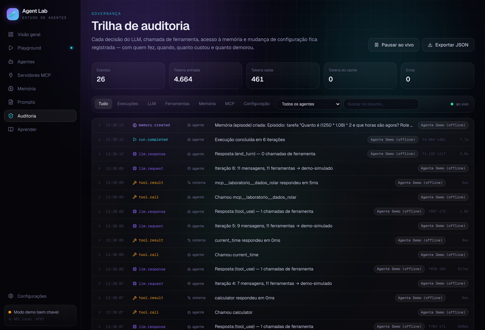
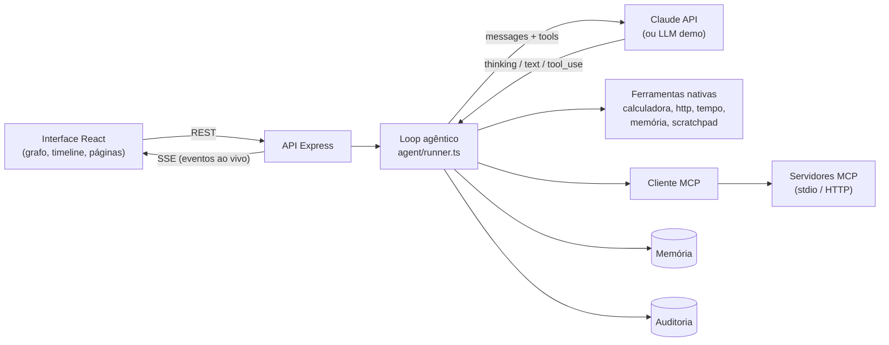

# 🧪 Agent Lab

**Uma plataforma visual para estudar agentes autônomos por dentro.** Os agentes funcionam de verdade, com o Claude
ou com um LLM simulado. Você conecta servidores **MCP**, cria **prompts**, gerencia **memória** e acompanha
toda a **auditoria**, enquanto um grafo animado mostra cada decisão do agente em tempo real.


## O que dá pra fazer

| Tela | O que você aprende/faz |
|---|---|
| **Playground** | Dá uma tarefa e assiste ao loop agêntico ao vivo: grafo animado (LLM ↔ ferramentas ↔ memória), linha do tempo com o raciocínio, cada `tool_use`/`tool_result`, tokens por iteração. Inspeciona a janela de contexto exata enviada ao modelo. Continua a conversa (memória de curto prazo) e aprova ou nega ferramentas (*human-in-the-loop*). |
| **Agentes** | Cria agentes: modelo, *effort*, prompt de sistema, ferramentas nativas e MCP, política de memória, limite de iterações, aprovação humana. |
| **Servidores MCP** | Conecta servidores MCP via `stdio` ou HTTP (com presets), vê as ferramentas descobertas, testa qualquer `tools/call` manualmente e acompanha os logs da conexão. |
| **Memória** | As 4 camadas (curto prazo, trabalho, longo prazo, episódica), uma "constelação" animada das memórias e um laboratório que mostra **por que** cada memória foi recuperada (pontuação detalhada). |
| **Prompts** | Biblioteca de prompts de sistema (ReAct, Planejador, Crítico interno) e de tarefa com `{{variáveis}}`. |
| **Auditoria** | Trilha completa e ao vivo: quem fez o quê, quando, quanto custou (tokens) e quanto demorou. Filtros e exportação em JSON. |
| **Aprender** | Explicações animadas do loop, do protocolo de ferramentas, glossário e uma lista de experimentos guiados. |

<p>
  
  
  
  
</p>

## Começando

Requisitos: **Node.js 20+**.

```bash
npm install
cp .env.example .env      # opcional: coloque sua ANTHROPIC_API_KEY
npm run dev               # API em :8787 e interface em http://localhost:5173
```

- **Sem chave de API?** Use o **Agente Demo (offline)**. O "LLM" é simulado (reage a palavras-chave), mas as ferramentas,
  a memória, o MCP e a auditoria são reais. Dá pra entender o loop inteiro sem gastar nada.
- **Com chave:** defina `ANTHROPIC_API_KEY` no `.env` ou cole em *Configurações*. Os agentes usam `claude-opus-5-5` por
  padrão (dá pra trocar por Sonnet 5.5, Haiku 5.5 ou Fable 5.2 no editor).
- Um servidor MCP de exemplo (`laboratorio`) já vem configurado e conecta sozinho.

Produção: `npm run build && npm start` (a API passa a servir a interface compilada em `http://localhost:8787`).

## Como funciona



O coração é [`server/src/agent/runner.ts`](server/src/agent/runner.ts). A cada iteração:

1. monta o **contexto**: prompt de sistema + memórias recuperadas automaticamente + histórico de mensagens;
2. chama o **Claude** com a lista de ferramentas (streaming, pensamento adaptativo com resumo visível e cache do prefixo);
3. se a resposta tem `tool_use`, **executa as ferramentas** (em paralelo; opcionalmente pede aprovação) e devolve todos os `tool_result` numa única mensagem;
4. repete até `stop_reason: end_turn` ou até o limite de iterações. Ao final, pode salvar um **episódio** na memória.

Cada passo emite um evento (para a visualização) e um registro de auditoria. Tudo fica salvo em
`server/data/db.json`: abra o arquivo e veja exatamente o que a plataforma guarda.

### Estrutura

```
server/src/
  agent/runner.ts      loop agêntico (leia este primeiro)
  agent/demo.ts        LLM simulado para o modo offline
  agent/llm.ts         cliente da Anthropic, modelos e preços
  mcp/manager.ts       conexões MCP (stdio, Streamable HTTP, SSE)
  tools/builtin.ts     ferramentas nativas (+ calculator.ts sem eval)
  memory.ts            memória de longo prazo e ranking
  audit.ts, store.ts   auditoria e persistência em JSON
  index.ts             rotas REST + SSE
mcp-servers/laboratorio/  servidor MCP de exemplo, ótimo para aprender a criar o seu
web/src/
  pages/               uma página por tela
  components/          AgentGraph (React Flow), Timeline, efeitos visuais
  lib/runState.ts      transforma o fluxo de eventos em estado visual
docs/pesquisa-visual.md   pesquisa de repositórios de animação e skills de design
```

### Conectando outros servidores MCP

Em **Servidores MCP → Adicionar servidor**, escolha um preset (Everything, Filesystem, Memory, Fetch, Git) ou preencha
o comando. As ferramentas aparecem como `mcp__<servidor>__<ferramenta>` e podem ser habilitadas por agente
(todas com `mcp__<servidor>__*` ou uma a uma). Para criar o seu, copie `mcp-servers/laboratorio/index.ts`.

### Segurança (é um laboratório local)

- `http_fetch` bloqueia endereços locais e privados; a calculadora não usa `eval`.
- O Markdown renderizado só gera links `http(s)`.
- Limite de iterações por agente e aprovação humana opcional para cada ferramenta.
- A chave salva pela interface fica em `server/data/` (fora do git). Não exponha o servidor na internet sem autenticação.

## Visual

Os efeitos (aurora, spotlight, number ticker, border beam, animated beam, blur text) foram reimplementados com
[`motion`](https://motion.dev), inspirados em React Bits, Magic UI e Aceternity. A pesquisa completa sobre esses
repositórios e as *skills* de design para agentes de código está em [`docs/pesquisa-visual.md`](docs/pesquisa-visual.md).

**Stack:** Node + Express + TypeScript, `@anthropic-ai/sdk`, `@modelcontextprotocol/sdk` · React 19 + Vite + Tailwind CSS 4 + Motion + React Flow.
