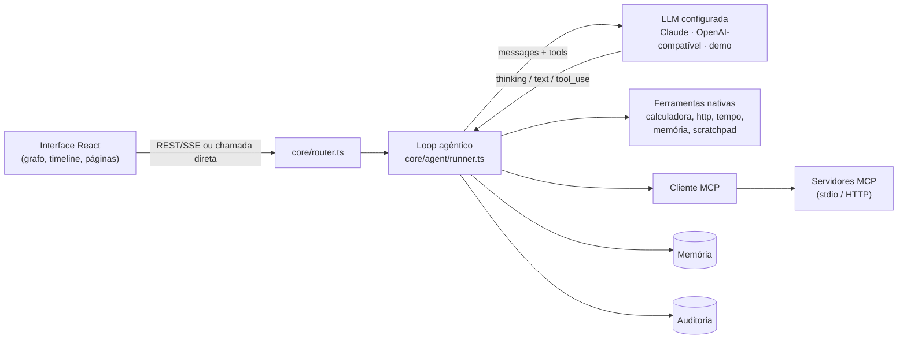

# 🧪 Agent Lab

**Uma plataforma visual para estudar agentes autônomos por dentro.** Os agentes funcionam de verdade, com o Claude,
qualquer API compatível com OpenAI (OpenRouter, Groq, Ollama…) ou um LLM simulado. Você conecta servidores **MCP**, cria **prompts**, gerencia **memória** e acompanha
toda a **auditoria**, enquanto um grafo animado mostra cada decisão do agente em tempo real.


## O que dá pra fazer

| Tela | O que você aprende/faz |
|---|---|
| **Playground** | Dá uma tarefa e assiste ao loop agêntico ao vivo: grafo animado (LLM ↔ ferramentas ↔ memória), linha do tempo com o raciocínio, cada `tool_use`/`tool_result`, tokens por iteração. Inspeciona a janela de contexto exata enviada ao modelo. Continua a conversa (memória de curto prazo) e aprova ou nega ferramentas (*human-in-the-loop*). |
| **Agentes** | Cria agentes: LLM, prompt de sistema, ferramentas nativas e MCP, política de memória, limite de iterações, aprovação humana. |
| **LLMs** | Cadastra quantas LLMs quiser em tempo de execução (provedor, modelo, chave, URL base, *effort*) e escolhe qual cada agente usa. Troque a LLM de um agente e compare na auditoria. |
| **Servidores MCP** | Conecta servidores MCP via `stdio` ou HTTP (com presets), vê as ferramentas descobertas, testa qualquer `tools/call` manualmente e acompanha os logs da conexão. |
| **Memória** | As 4 camadas (curto prazo, trabalho, longo prazo, episódica), uma "constelação" animada das memórias e um laboratório que mostra **por que** cada memória foi recuperada (pontuação detalhada). |
| **Prompts** | Biblioteca de prompts de sistema (ReAct, Planejador, Crítico interno) e de tarefa com `{{variáveis}}`. |
| **Auditoria** | Trilha completa e ao vivo: quem fez o quê, quando, quanto custou (tokens) e quanto demorou. Filtros e exportação em JSON. |
| **Aprender** | Explicações animadas do loop, do protocolo de ferramentas, glossário e uma lista de experimentos guiados. |

<p>
  
  
  
  
</p>

## Testar online

O workflow [`deploy-pages.yml`](.github/workflows/deploy-pages.yml) publica a interface no **GitHub Pages**:
**https://leonardoletr.github.io/poc_agents_plataform/**

Lá a plataforma roda em **modo navegador**: o núcleo inteiro executa dentro da sua aba, os dados ficam no
`localStorage` e cada pessoa cadastra as próprias chaves em **LLMs**. As chaves vão direto do seu browser
para o provedor, sem passar por nenhum servidor nosso. Limitações desse modo: não há MCP via `stdio` (use HTTP ou o servidor
embutido `laboratorio`) e `http_fetch` só alcança sites que liberam CORS.

> Na primeira vez, ative o Pages em **Settings → Pages → Source: GitHub Actions**, caso o workflow não consiga ativá-lo sozinho.

## Rodar localmente (modo servidor)

Requisitos: **Node.js 20+**.

```bash
npm install
cp .env.example .env      # opcional: coloque sua ANTHROPIC_API_KEY
npm run dev               # API em :8787 e interface em http://localhost:5173
```

- **Sem chave de API?** Use o **Agente Demo (offline)**. O "LLM" é simulado (reage a palavras-chave), mas as ferramentas,
  a memória, o MCP e a auditoria são reais. Dá pra entender o loop inteiro sem gastar nada.
- **Com chave:** cole a chave na LLM em **LLMs**, ou defina `ANTHROPIC_API_KEY` / `OPENAI_API_KEY` no `.env` (usadas quando
  a LLM não tem chave própria). As LLMs de exemplo usam `claude-opus-5-5` e `claude-haiku-5-5`.
- Um servidor MCP de exemplo (`laboratorio`) já vem embutido e conecta sozinho.
- Sem servidor rodando, a interface cai automaticamente para o modo navegador.

Produção: `npm run build && npm start` (a API passa a servir a interface compilada em `http://localhost:8787`).

## Como funciona

A lógica inteira mora em [`core/`](core/), um núcleo **sem dependências de Node**. Ele roda de dois jeitos:

| | Modo servidor (`npm run dev`) | Modo navegador (GitHub Pages) |
|---|---|---|
| Onde o núcleo roda | processo Node | dentro da aba do browser |
| Como a UI chama a API | HTTP + SSE | chamada de função direta |
| Dados | `server/data/db.json` | `localStorage` |
| MCP | stdio, HTTP e embutido | HTTP e embutido |



O coração é [`core/agent/runner.ts`](core/agent/runner.ts). A cada iteração:

1. monta o **contexto**: prompt de sistema + memórias recuperadas automaticamente + histórico de mensagens;
2. chama a **LLM do agente** com a lista de ferramentas. No Claude isso usa streaming, pensamento adaptativo com resumo visível e cache do prefixo; provedores OpenAI-compatíveis têm o histórico convertido (`tool_use` ↔ `tool_calls`);
3. se a resposta tem `tool_use`, **executa as ferramentas** (em paralelo; opcionalmente pede aprovação) e devolve todos os `tool_result` numa única mensagem;
4. repete até `stop_reason: end_turn` ou até o limite de iterações. Ao final, pode salvar um **episódio** na memória.

Cada passo emite um evento (para a visualização) e um registro de auditoria. No modo servidor tudo fica salvo em
`server/data/db.json`: abra o arquivo e veja exatamente o que a plataforma guarda.

### Estrutura

```
core/                  núcleo compartilhado (servidor e navegador)
  agent/runner.ts      loop agêntico (leia este primeiro)
  llm/                 provedores: anthropic.ts, openai.ts, demo.ts
  mcp/manager.ts       conexões MCP (stdio injetado, Streamable HTTP, SSE, em memória)
  mcp/lab-server.ts    servidor MCP de exemplo, ótimo para aprender a criar o seu
  tools/builtin.ts     ferramentas nativas (+ calculator.ts sem eval)
  memory.ts            memória de longo prazo e ranking
  router.ts            a API inteira (rotas + streams)
  seed.ts              dados de exemplo e migração de versões
server/src/index.ts    hospedeiro Node: arquivo JSON, MCP stdio, HTTP/SSE
web/src/
  lib/runtime.ts       escolhe servidor ou navegador
  pages/               uma página por tela
  components/          AgentGraph (React Flow), Timeline, efeitos visuais
docs/                  pesquisa visual e conceitos de design
.github/workflows/     CI e deploy no GitHub Pages
```

### Conectando outros servidores MCP

Em **Servidores MCP → Adicionar servidor**, escolha um preset (Everything, Filesystem, Memory, Fetch, Git) ou preencha
o comando. As ferramentas aparecem como `mcp__<servidor>__<ferramenta>` e podem ser habilitadas por agente
(todas com `mcp__<servidor>__*` ou uma a uma). Para criar o seu, copie `core/mcp/lab-server.ts`. O mesmo servidor roda
como processo stdio em `mcp-servers/laboratorio/index.ts`.

### Segurança

- `http_fetch` bloqueia endereços locais e privados; a calculadora não usa `eval`.
- O Markdown renderizado só gera links `http(s)`.
- Limite de iterações por agente e aprovação humana opcional para cada ferramenta.
- A API nunca devolve chaves (só os 4 últimos caracteres). No modo servidor elas ficam em `server/data/` (fora do git).
- **Modo navegador (GitHub Pages):** a chave nunca vai para o GitHub nem para um servidor intermediário. Ela é enviada direto do
  seu browser ao provedor por HTTPS e fica num cofre separado dos outros dados. Por padrão o cofre é o `sessionStorage`, que
  some quando você fecha o navegador. A opção *Lembrar chaves neste navegador* passa para o `localStorage`.
  O build publicado tem uma **Content-Security-Policy** que só permite scripts do próprio site.
  Mesmo assim, use uma **chave dedicada, com limite de gastos**, e revogue quando terminar. Extensões de navegador e outros
  projetos publicados em `leonardoletr.github.io` (mesma origem) conseguem ler o armazenamento da página.
- Não exponha o servidor local na internet sem autenticação.

## Visual

Os efeitos (aurora, spotlight, number ticker, border beam, animated beam, blur text) foram reimplementados com
[`motion`](https://motion.dev), inspirados em React Bits, Magic UI e Aceternity. A pesquisa completa sobre esses
repositórios e as *skills* de design para agentes de código está em [`docs/pesquisa-visual.md`](docs/pesquisa-visual.md).

**Stack:** Node + Express + TypeScript, `@anthropic-ai/sdk`, `@modelcontextprotocol/sdk` · React 19 + Vite + Tailwind CSS 4 + Motion + React Flow.
