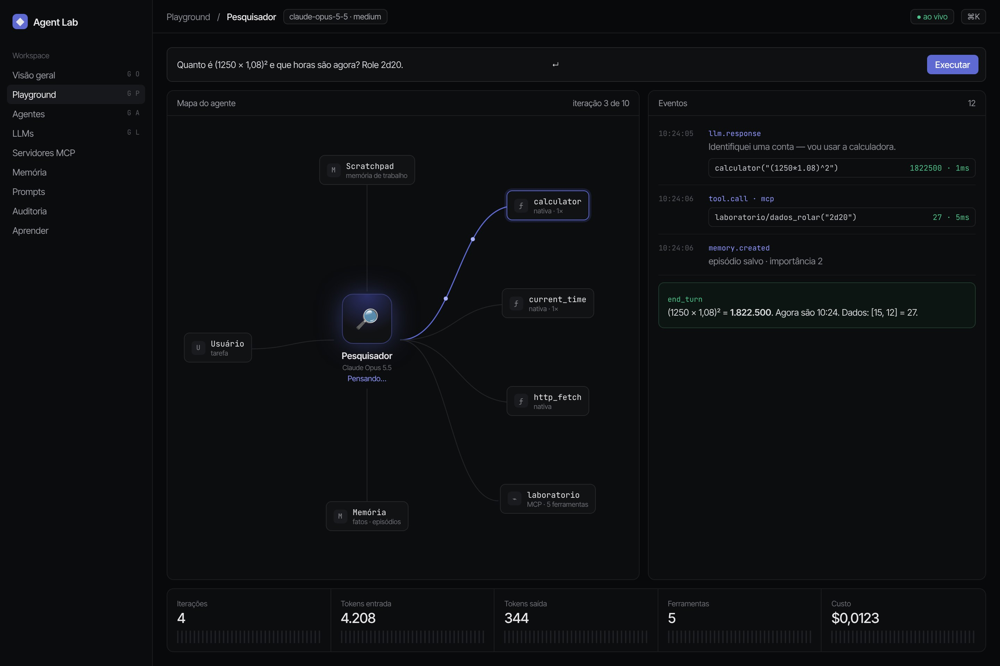
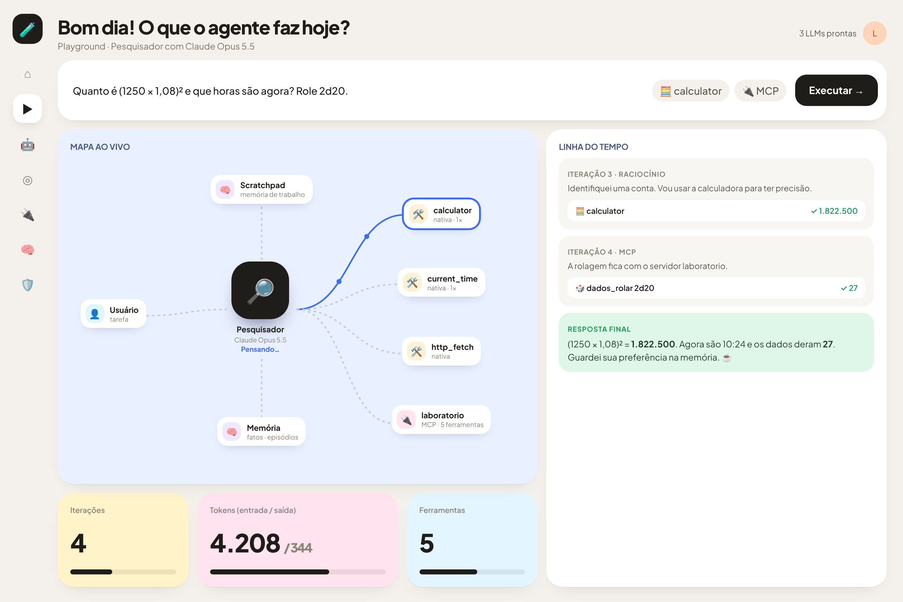
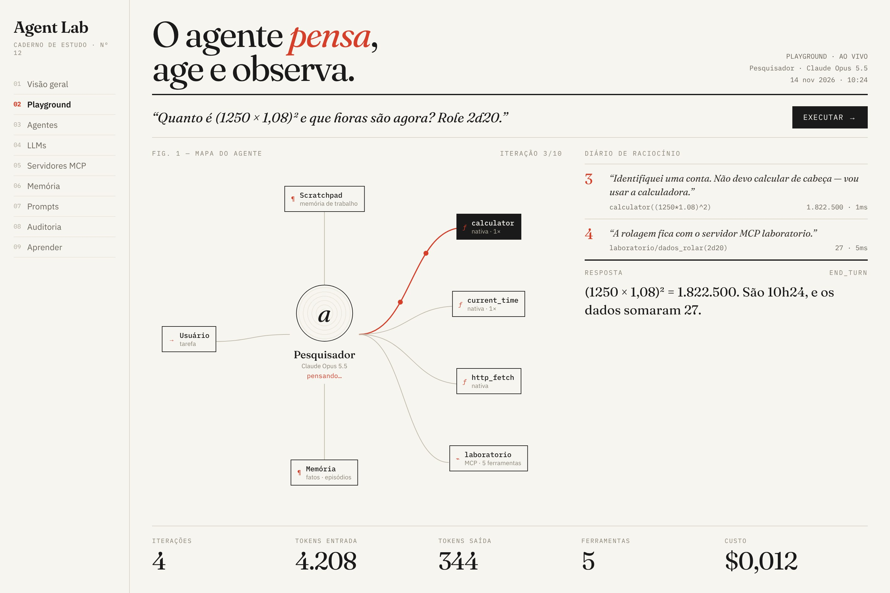

# Estudos de layout da tela principal

Cinco estudos visuais da mesma tela, o **Playground** (grafo do agente, linha do tempo e métricas), elaborados para
avaliar direções de design. Cada estudo é um arquivo HTML autônomo; as imagens foram renderizadas a partir deles.

| # | Estudo | Características | Pontos fortes | Limitações |
|---|---|---|---|---|
| 1 | **Liquid Glass** | Superfícies translúcidas sobre fundo em gradiente, cantos amplos. | Destaque visual do grafo | Contraste de texto sobre vidro; custo de renderização do `backdrop-filter` |
| 2 | **Minimal escuro** | Fundo quase preto, bordas de 1px, uma cor de destaque, tipografia compacta. | Alta densidade de informação | Menor acolhimento para usuários iniciantes |
| 3 | **Bento** | Fundo claro, cartões em grade, métricas em tons suaves. | Clareza e leitura confortável | Menor densidade de informação |
| 4 | **Neo-brutalismo** | Bordas espessas, sombras sólidas, cores chapadas. | Identidade visual marcante | Fadiga visual em telas densas |
| 5 | **Editorial** | Tipografia serifada, grid rigoroso, uma cor de destaque. | Leitura agradável e hierarquia clara | Menos espaço para controles |

O sistema visual adotado combina a estrutura do estudo 2 com a organização em cartões do estudo 3, em paleta clara.
A especificação está em [`.claude/skills/agent-lab-ui`](../../.claude/skills/agent-lab-ui/SKILL.md).

## Referências

- Superfícies translúcidas (*Liquid Glass*) são a tendência mais citada para 2026, impulsionada pelo iOS 26.
- Grades do tipo *bento* são um padrão consolidado em dashboards.
- O neo-brutalismo é recomendado como recurso pontual, não como linguagem principal.
- Guias de interfaces para agentes destacam transparência de estado, controle pelo usuário e recuperação de erros.
  Por isso todos os estudos mantêm em evidência o grafo, o indicador de atividade e a linha do tempo.

Fontes: [DesignRush](https://www.designrush.com/agency/website-design-development/trends/web-design-trends) ·
[Bubble](https://bubble.io/blog/web-design-trends/) · [UXPilot](https://uxpilot.ai/blogs/product-design-trends) ·
[Line25](https://line25.com/articles/web-design-trends-2026/) · [Muzli](https://www.muz.li/blog/best-dashboard-design-examples-inspirations-for-2026) ·
[Fuselab](https://fuselabcreative.com/ui-design-for-ai-agents/) · [SuperDesign](https://superdesign.dev/blog/ai-dashboard-ui-design)
