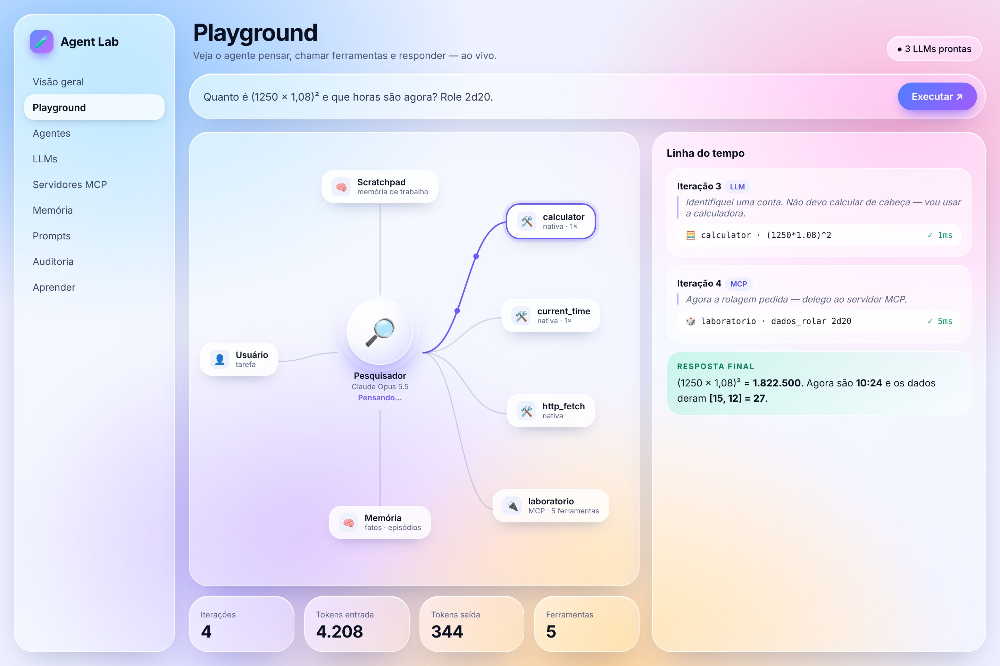
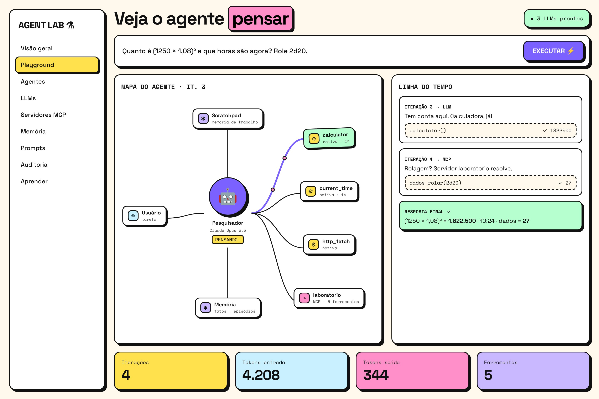

# Conceitos de design da tela principal

A mesma tela (o **Playground**: grafo do agente, linha do tempo e métricas) desenhada em 5 direções visuais
atuais. Cada conceito é um HTML real (abra o `.html` no navegador). As imagens foram renderizadas a partir deles.

| # | Conceito | Ideia | Bom para | Cuidado |
|---|---|---|---|---|
| 1 | **Liquid Glass** | Vidro translúcido sobre um fundo de gradiente vivo (linguagem do iOS 26). Cantos generosos, brilho interno. | Sensação premium e leve; destaca o grafo como "objeto" | Contraste do texto sobre vidro; custo do `backdrop-filter` |
| 2 | **Minimal escuro (estilo Linear)** | Quase preto, bordas de 1px, um único acento índigo, tipografia compacta e atalhos de teclado. | Uso diário e intenso; densidade de informação | Pode parecer "frio" para quem está aprendendo |
| 3 | **Bento suave** | Fundo creme, cartões brancos em grade *bento*, métricas em tons pastel, cabeçalho amigável. | Didático e acolhedor; ótimo para iniciantes | Ocupa mais espaço por informação |
| 4 | **Neo-brutalismo suave** | Bordas pretas grossas, sombras sólidas deslocadas, cores chapadas (amarelo, rosa, lilás), Space Grotesk. | Personalidade forte; vira "marca" | Usar com moderação: cansa em telas densas |
| 5 | **Editorial** | Papel, serifa expressiva (Fraunces), grid suíço, um acento vermelho, numeração de "caderno". | Narrativa de estudo ("caderno de laboratório"); leitura agradável | Menos espaço para controles/ações |

## De onde vieram as direções

- **Liquid Glass** aparece como a direção mais comentada de 2026, puxada pelo iOS 26.
- **Bento grids** são tratados como padrão consolidado para dashboards.
- **Neo-brutalismo** funciona melhor "como acento, não como fantasia".
- Para interfaces de agentes, os guias insistem em **transparência de status**, **controle/override** e **recuperação de erro**.
  Por isso todos os conceitos mantêm o grafo, o estado "pensando…" e a linha do tempo em destaque.

Fontes: [DesignRush](https://www.designrush.com/agency/website-design-development/trends/web-design-trends) ·
[Bubble](https://bubble.io/blog/web-design-trends/) · [UXPilot](https://uxpilot.ai/blogs/product-design-trends) ·
[Line25](https://line25.com/articles/web-design-trends-2026/) · [Muzli: dashboards 2026](https://www.muz.li/blog/best-dashboard-design-examples-inspirations-for-2026) ·
[Fuselab: UI para agentes](https://fuselabcreative.com/ui-design-for-ai-agents/) · [SuperDesign](https://superdesign.dev/blog/ai-dashboard-ui-design)
